# Kadpad Staking Contract Flow Diagram

This document outlines the complete flow for the Kadpad staking system on Kadena blockchain.

## Overview

Kadpad's staking system rewards long-term commitment with exclusive IDO access. Users must stake $KPAD tokens for exactly 1 year to participate in Initial DEX Offerings (IDOs) across three distinct tiers.

## Staking Tiers

| Tier | Token Requirement | Lockup Period | IDO Allocation Benefit |
|------|------------------|---------------|------------------------|
| 🟤 **Node** | 50,000 $KPAD | 1 Year | 10 random allocation spots per IDO |
| 🥈 **Cluster** | 150,000 $KPAD | 1 Year | 25 random allocation spots per IDO |
| 🥇 **Chainweb** | 350,000 $KPAD | 1 Year | **Guaranteed allocation** + Premium perks |

## Staking Flow Diagram

```mermaid
flowchart TD
    A["🔗 User Connects Wallet"] --> B["💰 Check $KPAD Balance"]
    B --> C{"Has Sufficient $KPAD?"}
    C -->|❌ No| D["⚠️ Show Insufficient Balance Error"]
    C -->|✅ Yes| E["🎯 Select Staking Tier"]
    
    E --> F{"Choose Tier"}
    F -->|Node| G["🟤 Node Tier<br/>Min: 50,000 $KPAD<br/>Lockup: 1 Year<br/>IDO: 10 random allocations"]
    F -->|Cluster| H["🥈 Cluster Tier<br/>Min: 150,000 $KPAD<br/>Lockup: 1 Year<br/>IDO: 25 random allocations"]
    F -->|Chainweb| I["🥇 Chainweb Tier<br/>Min: 350,000 $KPAD<br/>Lockup: 1 Year<br/>IDO: Guaranteed allocation"]
    
    G --> J["✅ Confirm Stake Amount ≥ 50K"]
    H --> K["✅ Confirm Stake Amount ≥ 150K"]
    I --> L["✅ Confirm Stake Amount ≥ 350K"]
    
    J --> M["📝 Execute Stake Transaction"]
    K --> M
    L --> M
    
    M --> N{"Transaction Successful?"}
    N -->|❌ No| O["🚫 Show Transaction Error"]
    N -->|✅ Yes| P["🔒 $KPAD Locked for 1 Year"]
    
    P --> Q["👥 User Added to Tier Pool"]
    Q --> R["⏰ Start 1 Year Lockup Timer"]
    R --> S["📊 Update User Dashboard"]
    
    S --> T{"🚀 IDO Launch Event"}
    T --> U["🎲 IDO Allocation Process"]
    U --> V{"Tier-Based Allocation"}
    
    V -->|Node Pool| W["🎯 Random Draw<br/>10 winners from Node stakers<br/>Odds = 10/total_node_stakers"]
    V -->|Cluster Pool| X["🎯 Random Draw<br/>25 winners from Cluster stakers<br/>Odds = 25/total_cluster_stakers"]
    V -->|Chainweb Pool| Y["⭐ Guaranteed Allocation<br/>Equal division among all Chainweb stakers<br/>+ Private/Seed Round Access"]
    
    W --> Z["📧 Notify Selected Winners"]
    X --> Z
    Y --> AA["🎉 Notify All Chainweb Members<br/>+ Private Channel Access"]
    
    AA --> BB["💎 IDO Participation Available"]
    Z --> BB
    
    BB --> CC["🔒 1 Year Lockup Active"]
    CC --> DD{"Lockup Period Complete?"}
    DD -->|❌ No| EE["⏳ Tokens Remain Locked<br/>Cannot Withdraw"]
    DD -->|✅ Yes| FF["🔓 Unstaking Available"]
    
    EE --> GG{"Next IDO Launch?"}
    GG -->|✅ Yes| T
    GG -->|❌ No| DD
    
    FF --> HH{"User Wants to Unstake?"}
    HH -->|❌ No| II["🔄 Continue Staking<br/>Maintain IDO Eligibility"]
    HH -->|✅ Yes| JJ["📤 Execute Unstake"]
    
    II --> GG
    JJ --> KK["💰 Return $KPAD to User Wallet"]
    KK --> LL["❌ Remove from All Tier Pools"]
    LL --> MM["🚫 Lose IDO Eligibility"]
    MM --> NN["🏁 End Staking"]
    
    style G fill:#8B4513,color:#fff,stroke:#5D2F0A,stroke-width:2px
    style H fill:#C0C0C0,color:#000,stroke:#808080,stroke-width:2px
    style I fill:#FFD700,color:#000,stroke:#B8860B,stroke-width:2px
    style W fill:#8B4513,color:#fff,stroke:#5D2F0A,stroke-width:2px
    style X fill:#C0C0C0,color:#000,stroke:#808080,stroke-width:2px
    style Y fill:#FFD700,color:#000,stroke:#B8860B,stroke-width:2px
    style AA fill:#FFD700,color:#000,stroke:#B8860B,stroke-width:2px
    
    classDef errorClass fill:#ffebee,stroke:#f44336,stroke-width:2px,color:#000
    classDef successClass fill:#e8f5e8,stroke:#4caf50,stroke-width:2px,color:#000
    classDef processClass fill:#e3f2fd,stroke:#2196f3,stroke-width:2px,color:#000
    
    class D,O,MM errorClass
    class P,BB,KK successClass
    class M,U,JJ processClass
```

## Key Features Explained

### 🔐 Core Mechanics
- **IDO Eligibility**: Only users who have staked $KPAD tokens can participate in IDO launches
- **Mandatory 1-Year Lock-up**: All staked tokens are locked for exactly 365 days with no early withdrawal option
- **Multi-IDO Participation**: Stakers remain eligible for all IDO launches during their lockup period
- **Tier-Based Benefits**: Higher tiers provide better allocation opportunities

### 🎲 Allocation System
- **Node & Cluster Tiers**: Fair random lottery system with transparent odds calculation
- **Chainweb Tier**: Guaranteed participation in every IDO launch
- **Equal Treatment**: All users within the same tier have equal chances/allocations
- **Transparent Process**: Random selection algorithms are verifiable and fair

### 💎 Chainweb Premium Benefits
- **Guaranteed IDO Access**: Never miss an opportunity
- **Private/Seed Rounds**: Early access to exclusive investment rounds
- **Direct Team Communication**: Private channel access with the Kadpad team
- **Priority Support**: Enhanced customer support and assistance

### 📊 Technical Implementation
- **Smart Contract Security**: Built on Kadena's secure blockchain infrastructure
- **Automated Processes**: Lockup periods and allocations handled automatically
- **Pool Segregation**: Each tier operates independently to ensure fairness
- **Real-time Tracking**: Live dashboard updates for staking status and rewards

## How to Use This System

### Step 1: Preparation
1. Ensure you have a compatible Kadena wallet (Linx, X-Wallet, Koala)
2. Acquire sufficient $KPAD tokens for your desired tier
3. Connect your wallet to the Kadpad platform

### Step 2: Staking Process
1. **Select Tier**: Choose Node (50K), Cluster (150K), or Chainweb (350K)
2. **Confirm Amount**: Verify you meet the minimum requirement
3. **Execute Transaction**: Sign the staking transaction
4. **Wait for Confirmation**: Your tokens will be locked for 1 year

### Step 3: IDO Participation
1. **Monitor Launches**: Watch for new IDO announcements
2. **Check Eligibility**: Verify your tier status and allocation chances
3. **Participate**: Join IDOs based on your tier benefits
4. **Track Results**: Monitor allocation results and participation status

### Step 4: Post-Lockup
1. **Wait for Expiry**: 1-year lockup must complete fully
2. **Choose Path**: Continue staking or unstake your tokens
3. **Maintain Benefits**: Keep staking to retain IDO eligibility

## Important Notes

⚠️ **No Early Withdrawal**: The 1-year lockup period is mandatory and cannot be bypassed  
📈 **Compound Benefits**: Participating in multiple IDOs during lockup maximizes value  
🔄 **Continuous Eligibility**: Stakers can participate in all IDOs launched during their lockup  
⭐ **Tier Advantages**: Higher tiers provide significantly better allocation opportunities  

## Support & Resources

- **Documentation**: [Complete Kadpad Docs](https://docs.kadpad.xyz)
- **Community**: [Discord Server](https://discord.gg/xe5PTEUeDE)  
- **Updates**: [Twitter @kadpad_official](https://twitter.com/kadpad_official)
- **Support**: support@kadpad.xyz

---

*This staking system is designed to reward long-term commitment to the Kadpad ecosystem while ensuring fair and transparent access to high-quality IDO opportunities on Kadena.*