# Kadpad Staking Contract Flow Diagram

This document outlines the complete flow for the Kadpad staking system on Kadena blockchain.

## Overview

Kadpad's staking system rewards long-term commitment with exclusive IDO access. Users must stake $KPAD tokens for exactly 1 year to participate in Initial DEX Offerings (IDOs) across three distinct tiers.

## Staking Tiers

| Tier | Token Requirement | Lockup Period | IDO Allocation Benefit |
|------|------------------|---------------|------------------------|
| 🟤 **Node** | 50,000 $KPAD | 1 Year | 10 random allocation spots per IDO |
| 🥈 **Cluster** | 150,000 $KPAD | 1 Year | 25 random allocation spots per IDO |
| 🥇 **Chainweb** | 350,000 $KPAD | 1 Year | **Guaranteed allocation** + Premium perks |

## Penalty Mechanism

The penalty mechanism is based on a **linear decay model** calculated on a **daily basis**.

- **Initial Penalty**: 100%  
- **Staking Duration**: 365 days  
- **Daily Penalty Reduction Rate**: ~0.274% per day (100% ÷ 365)  

The smart contract calculates the precise penalty using the following formula:

Unstaking Penalty (%) = 100% - (~0.274% × Number of Full Days Staked)

This ensures that the penalty decreases smoothly and predictably, rewarding stakers for every 24 hours they remain committed to the protocol.

### Penalty Reduction Table

| Days Staked | Calculation | Penalty for Early Unstaking | Example (100K Staked) |
|-------------|-------------|-----------------------------|------------------------|
| Day 1 | 100% - (1 × ~0.274%) | 99.73% penalty | 270 tokens back |
| Day 30 | 100% - (30 × ~0.274%) | 91.78% penalty | 8,220 tokens back |
| Day 90 | 100% - (90 × ~0.274%) | 75.34% penalty | 24,660 tokens back |
| Day 182 | 100% - (182 × ~0.274%) | 50.17% penalty | 49,830 tokens back |
| Day 270 | 100% - (270 × ~0.274%) | 26.02% penalty | 73,980 tokens back |
| Day 364 | 100% - (364 × ~0.274%) | 0.27% penalty | 99,730 tokens back |
| Day 365 | Full term complete | 0% penalty | 100,000 tokens back |

## Staking Flow Diagram

```mermaid
graph TD
    A[Connect Kadena Wallet<br/><small>Linx, X-Wallet, Koala</small>] --> B[Check $KPAD Balance]
    B --> C{Has Sufficient $KPAD?}
    C -->|No| D[Show Insufficient Balance Error]
    C -->|Yes| E[Select Staking Tier]
    E --> F{Choose Tier}
    F -->|Node<br/>50K $KPAD| G[Confirm ≥ 50K $KPAD<br/><small>10 Random IDO Allocations</small>]
    F -->|Cluster<br/>150K $KPAD| H[Confirm ≥ 150K $KPAD<br/><small>25 Random IDO Allocations</small>]
    F -->|Chainweb<br/>350K $KPAD| I[Confirm ≥ 350K $KPAD<br/><small>Guaranteed IDO Allocation</small>]
    G & H & I --> J[Execute Staking Transaction]
    J --> K{Transaction Confirmed?}
    K -->|No| L[Show Transaction Error]
    K -->|Yes| M[Lock Tokens<br/><small>1-Year Lockup</small>]
    M --> N[Add to Tier Pool]
    N --> O[Update Staking Dashboard]
    O --> P{IDO Launch Available?}
    P -->|No| O
    P -->|Yes| Q[Process IDO Allocation]
    Q --> R{Which Tier?}
    R -->|Node| S[Random Draw<br/><small>10 Winners</small>]
    R -->|Cluster| T[Random Draw<br/><small>25 Winners</small>]
    R -->|Chainweb| U[Guaranteed Allocation<br/><small>+ Premium Perks</small>]
    S & T --> V[Notify Winners]
    U --> W[Notify All Chainweb Stakers]
    V & W --> X[Participate in IDO]
    X --> Y{Lockup Complete?}
    Y -->|No| Z[Tokens Locked<br/><small>Early Unstake Available</small>]
    Y -->|Yes| AA[Unlock Tokens<br/><small>No Penalty</small>]
    Z --> BB{Request Early Unstake?}
    BB -->|No| P
    BB -->|Yes| CC[Calculate Penalty<br/><small>100% minus 0.27397% per day staked</small>]
    CC --> DD[Show Receivable Amount]
    DD --> EE{Confirm Early Unstake?}
    EE -->|No| P
    EE -->|Yes| FF[Execute Early Unstake]
    FF --> GG[Burn Penalty Tokens]
    GG --> HH[Return Remaining $KPAD]
    HH --> II[Remove from Tier Pool<br/><small>Lose IDO Eligibility</small>]
    II --> JJ[End Staking<br/><small>Penalty Applied</small>]
    AA --> KK{Unstake Tokens?}
    KK -->|No| LL[Continue Staking<br/><small>Eligible for Next IDOs</small>]
    KK -->|Yes| MM[Execute Unstake<br/><small>No Penalty</small>]
    MM --> NN[Return 100% $KPAD]
    NN --> OO[Remove from Tier Pool]
    OO --> PP[End Staking<br/><small>No Penalty</small>]

%% Styles
style G fill:#D4A017,stroke:#A37A00,stroke-width:2px,color:#000
style H fill:#B0BEC5,stroke:#78909C,stroke-width:2px,color:#000
style I fill:#FFD700,stroke:#B8860B,stroke-width:2px,color:#000
style S fill:#D4A017,stroke:#A37A00,stroke-width:2px,color:#000
style T fill:#B0BEC5,stroke:#78909C,stroke-width:2px,color:#000
style U fill:#FFD700,stroke:#B8860B,stroke-width:2px,color:#000
style W fill:#FFD700,stroke:#B8860B,stroke-width:2px,color:#000
style CC fill:#FFCA28,stroke:#FFA000,stroke-width:2px,color:#000
style DD fill:#FFCA28,stroke:#FFA000,stroke-width:2px,color:#000
style EE fill:#FFCA28,stroke:#FFA000,stroke-width:2px,color:#000
style GG fill:#FFCA28,stroke:#FFA000,stroke-width:2px,color:#000

classDef errorClass fill:#FFEBEE,stroke:#F44336,stroke-width:2px,color:#000
classDef successClass fill:#E8F5E9,stroke:#4CAF50,stroke-width:2px,color:#000
classDef processClass fill:#E3F2FD,stroke:#2196F3,stroke-width:2px,color:#000

class D,L errorClass
class M,X,AA,NN,HH successClass
class J,Q,MM,FF processClass
```

## Key Features Explained

### 🔐 Core Mechanics

* **IDO Eligibility**: Only users who have staked \$KPAD tokens can participate in IDO launches
* **Mandatory 1-Year Lock-up**: All staked tokens are locked for exactly 365 days
* **Early Unstaking Option**: Users can unstake early but face a **linear penalty decay model**
* **Multi-IDO Participation**: Stakers remain eligible for all IDO launches during their lockup period
* **Tier-Based Benefits**: Higher tiers provide better allocation opportunities

### 🎲 Allocation System

* **Node & Cluster Tiers**: Fair random lottery system with transparent odds calculation
* **Chainweb Tier**: Guaranteed participation in every IDO launch
* **Equal Treatment**: All users within the same tier have equal chances/allocations
* **Transparent Process**: Random selection algorithms are verifiable and fair

### 💸 Penalty Mechanism Details

* **Initial Penalty**: 100%
* **Daily Linear Reduction**: Penalty decreases \~0.274% per day until it reaches 0% on Day 365
* **Precise Formula**: `Penalty% = 100% - (0.27397% × days_staked)`
* **Token Burning**: Penalty tokens are permanently removed from circulation
* **Immediate Effect**: Early unstaking removes user from all tier pools and IDO eligibility
* **Real-time Updates**: Dashboard shows current penalty percentage and receivable amount

### 💎 Chainweb Premium Benefits

* **Guaranteed IDO Access**: Never miss an opportunity
* **Private/Seed Rounds**: Early access to exclusive investment rounds
* **Direct Team Communication**: Private channel access with the Kadpad team
* **Priority Support**: Enhanced customer support and assistance

### 📊 Technical Implementation

* **Smart Contract Security**: Built on Kadena's secure blockchain infrastructure
* **Automated Processes**: Lockup periods and allocations handled automatically
* **Pool Segregation**: Each tier operates independently to ensure fairness
* **Real-time Tracking**: Live dashboard updates for staking status and rewards

## How to Use This System

### Step 1: Preparation

1. Ensure you have a compatible Kadena wallet (Linx, X-Wallet, Koala)
2. Acquire sufficient \$KPAD tokens for your desired tier
3. Connect your wallet to the Kadpad platform

### Step 2: Staking Process

1. **Select Tier**: Choose Node (50K), Cluster (150K), or Chainweb (350K)
2. **Confirm Amount**: Verify you meet the minimum requirement
3. **Execute Transaction**: Sign the staking transaction
4. **Wait for Confirmation**: Your tokens will be locked for 1 year

### Step 3: IDO Participation

1. **Monitor Launches**: Watch for new IDO announcements
2. **Check Eligibility**: Verify your tier status and allocation chances
3. **Participate**: Join IDOs based on your tier benefits
4. **Track Results**: Monitor allocation results and participation status

### Step 4: Post-Lockup Options

1. **Wait for Full Term**: Complete 1-year lockup for no penalty
2. **Early Unstaking**: Option available with penalty (100% reducing to 0% linearly)
3. **Continue Staking**: Keep staking to retain IDO eligibility after lockup expires

## Important Notes

⚠️ **Daily Early Unstaking Penalty**: Starts at 100% and reduces by \~0.274% every day until Day 365
📈 **Compound Benefits**: Participating in multiple IDOs during lockup maximizes value
🔄 **Continuous Eligibility**: Stakers can participate in all IDOs launched during their lockup
⭐ **Tier Advantages**: Higher tiers provide significantly better allocation opportunities
🔥 **Token Burning**: Penalty tokens are permanently removed from circulation

## Support & Resources

* **Documentation**: [Complete Kadpad Docs](https://docs.kadpad.xyz)
* **Community**: [Discord Server](https://discord.gg/xe5PTEUeDE)
* **Updates**: [Twitter @kadpad\_official](https://twitter.com/kadpad_official)
* **Support**: [support@kadpad.xyz](mailto:support@kadpad.xyz)

*This staking system is designed to reward long-term commitment to the Kadpad ecosystem while ensuring fair and transparent access to high-quality IDO opportunities on Kadena.*

